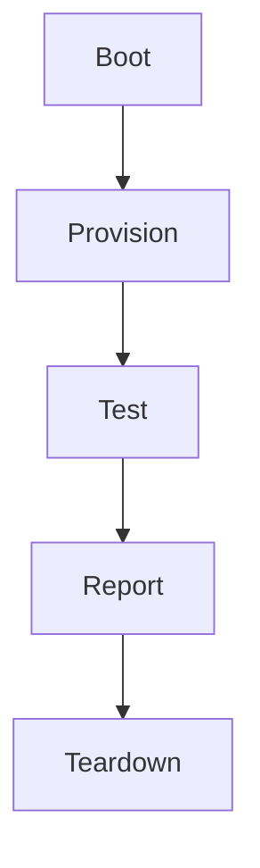
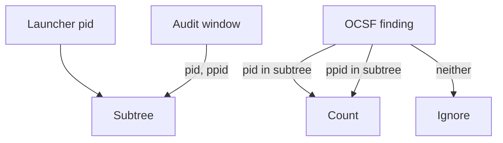

# mayfly

Boot N real Linux distros under KVM, run your checks on each, tear every VM
down. One command.

Like the insect: each VM is born at spin-up, lives for exactly one test run, and
is gone at teardown. No VM outlives its run, no overlay is left behind.

```sh
nix run .#matrix              # every enabled distro, every check
nix run .#distro-ubuntu-2404  # one distro
nix run .#distro-ubuntu-2404 -- -keep   # one distro, keep its work dir for a look
```

The distros are the vendors' own cloud images. Each boots on its own kernel, its
own systemd, its own auditd, its own SELinux or AppArmor. Nothing is emulated or
containerised. You write only declarative Nix. All the imperative fragility
(boot readiness, SSH, package installs, teardown) lives inside the harness.

## Contents

- [Why it exists](#why-it-exists)
- [Quick start](#quick-start)
- [Two test tiers](#two-test-tiers)
- [Distros: a catalog you flip on](#distros-a-catalog-you-flip-on)
- [The module API](#the-module-api)
- [How it works](#how-it-works)
- [Three ways to use it](#three-ways-to-use-it)
- [Worked examples](#worked-examples)
- [Requirements](#requirements)
- [Limitations](#limitations)
- [Roadmap](#roadmap)
- [License](#license)

## Why it exists

Two standard tools do not fit, which is the whole reason this harness exists.

- `runNixOSTest` boots only NixOS. It builds the guest from a NixOS config. It
  cannot boot a Rocky kernel or a Debian systemd.
- Containers share the host's audit stream. The Linux audit subsystem is not
  namespaced, so an EDR that reads auditd cannot be tested in a container.

So the harness boots real cloud images in QEMU under KVM. That is the only
general route to "this tool works on this distro as the vendor ships it".

Two audiences use the same repo:

- Anyone. Pass your own static binary and your own check. You get spin-up,
  provisioning, the test, and teardown over the whole distro set. No Go. No QEMU
  flags.
- The banken family. banken, mimi and hitomi each consume the repo as a flake
  input, each passing its own binary and checks. The result is the per-distro
  detection matrix the badges come from.

Reach for mayfly when your software touches the OS: a daemon, a systemd unit, a
tool that reads auditd, anything kernel-, init- or filesystem-dependent. You need
to know it behaves on a real Rocky or Debian as the vendor ships it, not on a
NixOS stand-in or a shared-kernel container. For pure userspace logic a normal CI
matrix is fine. mayfly earns its keep where the real OS matters.

## Quick start

Write one file, run one command, watch the matrix.

Put a `mayfly.nix` in your project. It is a mayfly module: you set the options,
and they are type-checked against the schema (a wrong field fails at eval with a
clear message).

```nix
# mayfly.nix
{ ... }:
{
  distros.ubuntu-2404.enable = true;
  distros.fedora-44.enable   = true;
  distros.debian-13.enable   = true;

  install = {
    binary   = ./mytool;                       # installed onto PATH in each guest
    packages = [ "curl" ];                     # installed first, per distro
    unit     = ./mytool.service;               # installed, enabled and started
    files."/etc/mytool/config.yml" = ./config.yml;
  };

  test = ./check.sh;                           # run in-guest after the install is up
}
```

```sh
# check.sh: exit 0 is a pass
systemctl is-active --quiet mytool || { echo "not active"; exit 1; }
curl -fs --max-time 5 http://127.0.0.1:8080/health || exit 1
echo ok
```

Then, from that directory:

```sh
nix run github:conor-sometimes/mayfly        # reads ./mayfly.nix
```

Installed, it is just `mayfly`. Each distro either goes green or tells you
exactly which phase broke and why. A runnable sample is in
[`examples/quickstart/`](./examples/quickstart/).

Want to see it with zero setup first? `nix run github:conor-sometimes/mayfly#demo`
boots Ubuntu 24.04, installs a package, runs a check, and tears the VM down.

### No file at all

For a one-off with no `mayfly.nix`, pass the same fields as flags:

```sh
nix run github:conor-sometimes/mayfly -- \
  -binary ./mytool -unit ./mytool.service -test ./check.sh -distro ubuntu-2404
```

### Wired into your own flake

This is the pattern for shipping mayfly tests *inside your repo*, so anyone who
clones it can run them. Your binary is already a flake output, so the test can
reference it through `self`. Two small pieces:

A `mayfly.nix` at the repo root, reaching your own package via `self`:

```nix
# mayfly.nix
{ self, pkgs, ... }:
{
  distros.ubuntu-2404.enable = true;
  distros.fedora-44.enable   = true;

  install.binary = "${self.packages.x86_64-linux.mytool}/bin/mytool";
  install.unit   = ./mytool.service;

  test = ./check.sh;
}
```

And ~5 lines in your `flake.nix` to expose it as apps:

```nix
inputs.mayfly.url = "github:conor-sometimes/mayfly";
# ... in outputs, alongside your existing apps:
apps.x86_64-linux = (mayfly.lib.buildFromModules {
  inherit pkgs;
  modules     = [ ./mayfly.nix ];
  specialArgs = { inherit self; };   # lets mayfly.nix reach self.packages
}).apps;
```

Now anyone who clones your repo runs:

```sh
nix run .#matrix              # every enabled distro
nix run .#distro-ubuntu-2404  # just one
```

So the split is clear: `mayfly.nix` says *what* to test, the flake wiring says
*how to invoke it*. The person who cloned you types one command and watches the
matrix, with no setup of their own.

## Two test tiers

Pick the one that fits. Both run after the install block is provisioned and started.

- `test = ./check.sh` is the simple tier. The script runs as root in the guest.
  Exit 0 is a pass; any other exit fails the distro, with the script's last
  lines in the report. This is the "anyone can use it" path.
- `checks = { ... }` is the structured tier. It is the detection oracle: each
  `detect` check runs an emulation under its own launcher and attributes the
  installed software's OCSF findings to that check by process-subtree identity. This is
  what makes the banken matrix trustworthy. See [The module API](#the-module-api).

`test` is sugar; `checks` is the full engine. You can use either.

## Distros: a catalog you flip on

The repo ships a catalog of distros. You do not define a distro, you enable one:

```nix
distros = {
  ubuntu-2404.enable = true;
  rocky-9.enable = true;
  arch.enable = true;
};
```

The shipped catalog (`nix run .#readme` regenerates this table from the one
source of truth, `distros/catalog.nix`):

<!-- generated by `nix run .#readme`; do not edit by hand -->
| Distro | Attr | Package manager | Family |
| --- | --- | --- | --- |
| AlmaLinux 10 | `alma-10` | dnf | rhel |
| Amazon Linux 2023 | `amazonlinux-2023` | dnf | rhel |
| Arch Linux | `arch` | pacman | arch |
| Debian 13 | `debian-13` | apt | debian |
| Fedora 44 | `fedora-44` | dnf | rhel |
| openSUSE Leap 16 | `opensuse-leap-16` | zypper | suse |
| Rocky 9 | `rocky-9` | dnf | rhel |
| Ubuntu 22.04 | `ubuntu-2204` | apt | debian |
| Ubuntu 24.04 | `ubuntu-2404` | apt | debian |

### Many versions of one distro

A catalog entry is a base family overlaid with one version's image. Several
versions of one distro share the base, so adding a version is one URL and one
hash. Each version is its own attr, so `distro-ubuntu-2204` and
`distro-ubuntu-2404` run independently:

```nix
# distros/catalog.nix
ubuntu-2404 = mkVersion ubuntu {
  title = "Ubuntu 24.04";
  image = { url = "...noble...img"; sha256 = "04e8f2..."; };
};
ubuntu-2204 = mkVersion ubuntu {
  title = "Ubuntu 22.04";
  image = { url = "...jammy...img"; sha256 = "2099e6..."; };
};
```

The `ubuntu` base holds the shared bits: the package manager (apt), the
generic-name to package map, and the family tag. A version supplies only its
image, its checksum, and any one-off package override.

### A distro the catalog lacks

Add it as one extra attr in your own `distros`, with the same fields:

```nix
distros = {
  ubuntu-2404.enable = true;
  my-distro = {
    title = "My Distro 1.0";
    image = { url = "https://.../cloud.qcow2"; sha256 = "..."; };
    pm = "dnf";                       # dnf | apt | zypper | pacman
    family = "rhel";
    packages = { auditd = "audit"; curl = "curl"; python3 = "python3"; };
  };
};
```

## The module API

### Install

The `install` block is a declarative record of exactly what lands in each guest,
and is the thing under test. For more than one thing per guest, use named
`installs` (an attrset of these same blocks, provisioned in order).

| Field | Meaning |
| --- | --- |
| `binary` | a static binary; installed to `installPath`, default `/usr/local/bin/<name>` (on PATH) |
| `unit` / `units` | systemd unit file(s); installed, and enabled and started by default |
| `files` | a `{ "/guest/path" = ./source; }` map, copied verbatim |
| `packages` | generic package names, installed first via the distro's package manager |
| `enable` | units to `systemctl enable --now` (defaults to the unit basenames) |
| `setup` | a script run once as root after files land |
| `ocsf` | a glob of OCSF jsonl findings the installed software writes (for `detect` checks) |
| `scan` | a command that drives a batch install once (banken's oneshot scan); omit for a daemon |

`packages` is the key simplifier: you write generic names once (`[ "auditd"
"python3" "curl" ]`), and the per-distro catalog entry maps each to that
distro's spelling and package manager. "install auditd" works on every distro.
A name no distro maps is a clear error naming the distro and the name, never a
silent skip.

The static-binary rule: an installed binary must be statically linked, so it is
copy-and-run on any Linux of the same architecture. banken is CGO-free static
Go; mimi and hitomi are musl-static.

### Checks (the structured tier)

```nix
checks = {
  revshell = {
    kind = "detect";
    run = ../emulations/revshell.sh;   # runs under its own launcher
    as = "user";                       # "user" (alice) or "root"
    expect = [ "reverse_shell" ];      # the exact rule set, by subtree identity
  };
  portscan = {
    kind = "detect";
    run = ../emulations/portscan.sh;
    expect = [ "port_scan" ];
    tools = [ "nmap" ];
    optional = true;                   # tool missing on a distro = skip, not fail
  };
  sysmon = {
    kind = "script";
    run = ./sysmoncheck.sh;            # prints "<id> PASS|FAIL|SKIP <detail>" lines
    ids = [ "S1" "S2" "S3" "S4" "S5" ];
    when = d: d.pm == "apt" || d.family == "rhel";
  };
};
```

The check kinds:

- `detect`: run the emulation under a launcher, attribute the installed
  software's OCSF findings to it by process-subtree identity, and assert the fired rule set
  equals `expect` exactly. A miss fails. An extra fails.
- `script`: run a script as root and parse its `<id> PASS|FAIL|SKIP <detail>`
  lines, one check per declared id. A `SKIP` is recorded, not failed.
- `exit`: run a script as root; exit 0 is a pass. This is what `test = ...` is.
- `sandbox`: `systemd-analyze security <unit>` must rate the unit SAFE or OK.
- `lsm`: the distro's SELinux or AppArmor logged no denial mentioning the match.

A check's `when` predicate takes the distro attr and returns whether the check
applies to that distro. `tools` names commands the check needs, resolved like an
install's packages; `optional` turns a missing tool into a skip.

### Stage environment

Every check script (and `test`) runs with two environment variables set, so a
stage never hard-codes where things landed:

| Variable | Value |
| --- | --- |
| `MAYFLY_DISTRO` | the distro's attr (`ubuntu-2404`, `fedora-44`, ...) |
| `MAYFLY_BINARY` | the installed binary's guest path (absent when no binary was installed) |

This lets your test logic live in one place, your own `justfile`, so a check is a
one-line shim that runs the shipped binary the same way you do locally:

```nix
install = { binary = ./mytool; packages = [ "just" ]; };  # just, so the recipe runs in-guest
test = ./check.sh;
```

```sh
# check.sh: the one place test logic lives is the justfile
exec just mayfly-check "$MAYFLY_BINARY"
```

`just` is shown, never required: a check can do its own assertions directly.
mayfly only sets the variables.

### mkMatrix returns

```nix
{
  apps = {
    matrix = <app>;                 # every enabled distro
    "distro-ubuntu-2404" = <app>;   # one per enabled distro
    # ...
  };
  checks = { "distro-ubuntu-2404" = <derivation>; ... };   # needs a KVM builder
  readme = <derivation>;            # the generated distro table
}
```

Splice `apps` and `checks` into your own flake with `//`.

### Options reference

The full option set (distros, install, installs, test, checks, concurrency,
teardown, timeouts, ssh user) is declared in `lib/module.nix` and type-checked
at eval. The reference is generated from that schema, so it never drifts:

```sh
nix build .#options-doc && cat result   # Markdown of every mayfly.* option
```

## How it works

Every distro goes through the same five-stage lifecycle. The base image is
never written.



1. Boot. The pinned image sits read-only in the Nix store, fetched by the
   vendor's checksum, so a moved or tampered image never boots. The runner makes
   a copy-on-write overlay and boots it with KVM. A NoCloud seed ISO carries a
   per-run SSH key and a sudo user; the key dies with the run. The runner polls
   SSH with backoff, then waits for `cloud-init status --wait`. A guest that
   never comes up hits a timeout with a clear, distro-named error and the
   serial-console tail, not a silent hang.
2. Provision. The install's packages install via the distro's own package
   manager (with retry on a transient mirror failure). The binary, units and
   files are scp'd in, and the units are enabled and started.
3. Test. The in-guest oracle (`distrocheck`, itself a static binary) runs the
   checks.
4. Report. The oracle prints the per-check verdicts on SSH stdout; a guest that
   dies mid-run still reports how far it got.
5. Teardown. A trap kills QEMU and removes the overlay, on success, failure or
   Ctrl-C. Two layers: the runner itself, and the app wrapper's shell trap in
   case the runner is killed outright. No leaked VMs, no leaked disk.

Each distro is its own VM, its own forwarded port, its own result. One distro
failing or flaking never affects another.

### Deterministic attribution

A `detect` check attributes a finding to the emulation that caused it by
identity, not by a wall-clock window.



Every emulation runs under its own launcher process. Every exec auditd records
carries a pid and a ppid; every finding carries its evidence process's pid and
parent pid. A finding belongs to a check if and only if its process is in that
check's launcher subtree. A cron job or an fwupd run is under a different
subtree, so it is simply not attributed. A process's parentage is fixed at
fork, so auditd's async flush cannot change the verdict. There are zero
wall-clock races.

## Three ways to use it

- Way 1: a `mayfly.nix`, run in place. The headline path above. Bare
  `nix run github:conor-sometimes/mayfly` reads `./mayfly.nix`. For a one-off
  with no file, the same fields are flags:

  ```sh
  nix run github:conor-sometimes/mayfly -- \
    -binary ./foo -unit ./foo.service -test ./smoke.sh -distro ubuntu-2404
  ```

- Way 2: a flake input. Call `lib.mkMatrix` (or set `mayfly.*` with
  `lib.buildFromModules`) from your own flake. You get the matrix inside your own
  `nix run` and `nix flake check`.
- Way 3: a CI step. The same command on a KVM-capable runner. One distro fits a
  standard hosted runner; the full matrix runs on a bigger box. See
  `.github/workflows/ci.yml`.

Pushing tests at the matrix never means changing the matrix. Your binary, units
and scripts stay in your repo.

## Worked examples

Real projects on the matrix, each a small module under `examples/`. Find the one
closest to yours and copy it. Each uses `lib.fetchRelease` to fetch the
project's own static release by hash (not a nixpkgs rebuild), so the test is the
bytes the project ships, on the distro the vendor ships.

| Project | Kind | The check | Why it is a distro question |
| --- | --- | --- | --- |
| hitomi | YARA scanner | the EICAR suite: 100% TP, 0% FP | the shipped musl binary's accuracy on each distro ([`examples/hitomi/`](./examples/hitomi/)) |
| Caddy | web server | `curl localhost` returns `ok` | binding :80 as a service user under each distro's systemd |
| node_exporter | metrics agent | `/metrics` has the systemd collector | reads `/proc`, `/sys` and D-Bus; each distro's bus policy |
| Vector | log pipeline | a journald source reaches a file sink | shells out to each distro's `journalctl` |
| etcd | key-value store | `etcdctl put` then `get` | fsync on each distro's default filesystem |
| MinIO | object store | `/minio/health/live` is live | a `User=` with no login shell on every distro |

The Caddy example in full lives in `examples/caddy/`.

## Requirements

- KVM. `/dev/kvm` must be readable by the runner. Without it the engine refuses
  to start with a one-line reason. There is no TCG fallback.
- Network. Guests install packages from their vendors' repos. The host needs
  egress, or a proxy in `http_proxy` / `https_proxy`. Behind an egress
  allow-list the engine pins dnf and zypper to the vendors' own hosts.
- Disk. The images are a few GiB in the store, fetched once. Overlays need up to
  20 GiB each while a run lives.
- RAM and CPU. 2 GiB and 2 vCPUs per concurrent guest. Concurrency is bounded by
  the host unless `-parallel N` overrides it.
- CI. `nix flake check` is the pure gate (Go tests, formatting, the table
  check). The VM runs need KVM and a relaxed Nix sandbox, so they run via the
  apps (`nix run .#distro-<name>`) on a KVM host. This repo is private, so its
  Actions are billed: the matrix runs on hokkaido, and CI stays the pure gate.
  Flip the repo public for free Actions if you want one distro in CI too.

## Limitations

Know what mayfly is not before you reach for it.

- Nix required. mayfly is a Nix tool: you run it with `nix run`, and the config
  is a Nix module. There is no standalone, non-Nix binary today. The audience is
  Nix users (which is fine: it is the real-distro companion to `runNixOSTest`,
  which only boots NixOS).
- A Linux host with KVM. It boots real VMs, so it needs a Linux machine with
  `/dev/kvm`. It does not run on macOS, and it does not run in KVM-less CI
  (standard GitHub Actions runners have no nested virtualisation). A Linux box
  you control is its home.
- x86_64-linux only, for now. The catalog images and the flake target x86_64.
  aarch64 is a catalog-and-image question, not a design one.
- Ephemeral and binary modes only, for now. Every run boots a fresh VM; the
  warm-pool daemon that makes re-runs seconds is on the roadmap. The install is a
  pre-built binary; the clone-the-source-and-build-in-guest mode is on the
  roadmap too.
- NixOS guests are not in the catalog. For a NixOS guest, `runNixOSTest` is the
  right tool; mayfly is for the distros it cannot boot.

## Roadmap

| Item | Status |
| --- | :---: |
| Engine: catalog-enable, install, test and checks tiers, deterministic oracle | done |
| Ubuntu 24.04 proven end to end under KVM on hokkaido | done |
| SSH transport, cloud-init readiness, two-layer teardown | done |
| The other seven vendor distros (one catalog attr each) | in progress |
| Multi-version per distro (base plus overlay) | done |
| banken consumes it as a flake input; parity run | in progress |
| mimi and hitomi consume it | planned |
| NixOS as a ninth attr (image as a derivation) | planned |
| Five worked examples: Caddy, node_exporter, Vector, etcd, MinIO | planned |
| aarch64 distros (needs an aarch64 KVM host) | planned |
| Recorded results feed the generated README ticks | planned |

## License

MIT. See [LICENSE](./LICENSE).
